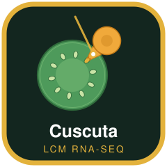
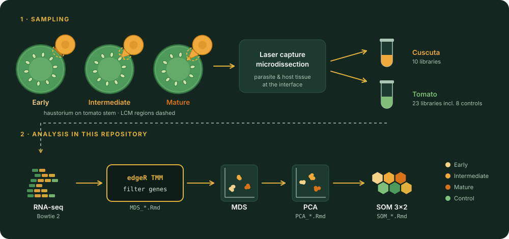

# Cuscuta LCM RNA-seq 

**Tissue-specific transcriptomics of the *Cuscuta campestris*–tomato haustorial interface by laser capture microdissection (LCM) RNA-seq**

[](https://doi.org/10.3389/fpls.2021.764843)


[](LICENSE.md)
[](https://doi.org/10.5281/zenodo.24096768)

This repository contains the analysis code and normalized data for:

> **Jhu M-Y**, Farhi M, Wang L, Zumstein K, Sinha NR (2022). Investigating host and parasitic plant interaction by tissue-specific gene analyses on tomato and *Cuscuta campestris* interface at three haustorial developmental stages. *Frontiers in Plant Science* 12: 764843. [doi:10.3389/fpls.2021.764843](https://doi.org/10.3389/fpls.2021.764843)

Parasite (haustorium) and host (tomato stem cortex) tissues at the haustorial interface were collected by LCM at three developmental stages, sequenced, and analyzed separately for each species with MDS, PCA and self-organizing maps (SOM) to find stage-specific gene expression patterns.

<p align="center">
  
</p>

## Study design

| | Stages (libraries) | Total | Reference genome |
|---|---|---|---|
| ***Cuscuta campestris*** (haustorium) | Early (5), Intermediate (3), Mature (2) | 10 | Vogel *et al.* 2018 |
| **Tomato** (host stem cortex) | Control (8), Early (8), Intermediate (4), Mature (3) | 23 | ITAG4.0 |

- **Early:** the prehaustorium has just touched the host surface.
- **Intermediate:** the haustorium has penetrated the cortex and formed searching hyphae, with no vascular connection yet.
- **Mature:** the haustorium has connected to the host vasculature.
- **Control:** tomato stem cortex not adjacent to a haustorium.

Reads were mapped with Bowtie 2 and normalized with edgeR (TMM). Both species are analyzed the same way; genes in the upper part of the coefficient-of-variation distribution are used for PCA and SOM.

## Repository structure

```
Cuscuta_LCM_project/
├── Cuscuta_LCM_RNA-Seq/
│   ├── TMM for 10 libs_LCM.csv            # input: normalized counts, 10 Cuscuta libraries
│   ├── MDS_dodder_updated_ID.Rmd          # 1. filtering, edgeR normalization, MDS
│   ├── PCA_dodder_updated_ID.Rmd          # 2. stage averages, CV filter, PCA
│   └── SOM_dodder_updated_ID.Rmd          # 3. 3x2 self-organizing map on PCA scores
├── Tomato_LCM_RNA-Seq/
│   ├── TMM-Counts-Unaveraged_all_Libraries_combined.csv   # input: 23 tomato libraries
│   ├── MDS_tomato_updated_ID.Rmd
│   ├── PCA_tomato_updated_ID.Rmd
│   └── SOM_tomato_updated_ID.Rmd
├── assets/                                # logo, workflow figure and their generator
├── docs/sessionInfo.txt                   # R session used to verify the analysis
├── environment.yml                        # tested conda environment
├── CITATION.cff
└── LICENSE.md
```

## How to run

1. Create the environment:

   ```bash
   micromamba create -f environment.yml
   micromamba activate cuscuta-lcm
   ```

2. In each species folder, run the notebooks **in order**, because each step reads files written by the previous one (MDS → PCA → SOM):

   ```bash
   cd Cuscuta_LCM_RNA-Seq
   for f in MDS PCA SOM; do Rscript -e "rmarkdown::render('${f}_dodder_updated_ID.Rmd')"; done
   cd ../Tomato_LCM_RNA-Seq
   for f in MDS PCA SOM; do Rscript -e "rmarkdown::render('${f}_tomato_updated_ID.Rmd')"; done
   ```

Each run writes HTML reports, PDF figures (MDS plots, PCA plots, SOM maps and cluster boxplots) and intermediate tables into the species folder. These outputs are ignored by Git.

## Reproducibility

All six notebooks were re-run from the included data in November 2026 and complete successfully (about 25 seconds in total). The SOM step sets a random seed, so cluster assignments are repeatable.

| Package | Version |
|---|---|
| R | 4.5.3 |
| edgeR | 4.10.7 |
| limma | 3.68.5 |
| kohonen | 3.0.13 |
| clusterSim | 0.51.6 |
| ggplot2 | 4.0.3 |
| reshape | 0.8.10 |
| gplots | 3.3.0 |

The full session is in [`docs/sessionInfo.txt`](docs/sessionInfo.txt). The original analysis was run in 2020–2021; if results differ, check package versions first.

## Data availability

Raw sequencing data are available from NCBI under BioProjects [PRJNA687611](https://www.ncbi.nlm.nih.gov/bioproject/PRJNA687611) and [PRJNA756681](https://www.ncbi.nlm.nih.gov/bioproject/PRJNA756681). The normalized count tables used by the notebooks are included in this repository.

## Related repositories

- [CcLBD25_project](https://github.com/MinYaoJhu/CcLBD25_project): *CcLBD25* functions as a key regulator of haustorium development in *Cuscuta campestris* (Jhu *et al.* 2021, *Plant Physiology*), a companion study on haustorium development

## Citation

If you use this code or data, please cite the article above and the archived code: Jhu M-Y (2026). *Cuscuta LCM RNA-seq* (v1.0.0). Zenodo. [doi:10.5281/zenodo.24096768](https://doi.org/10.5281/zenodo.24096768). GitHub's **"Cite this repository"** button (from [`CITATION.cff`](CITATION.cff)) gives the citation in APA and BibTeX formats.

## AI assistance

Documentation, figures and reproducibility checks in this repository were updated with the assistance of Claude Opus 5.5 (Anthropic), used through Claude Code. The original analysis code was written by Min-Yao Jhu. All changes were directed, reviewed and approved by the author, who takes full responsibility for the content.

## Contact

**Min-Yao Jhu**, Senior Research Scientist, Donald Danforth Plant Science Center
Email: [MJhu@danforthcenter.org](mailto:MJhu@danforthcenter.org) · Website: [minyaojhu.com](https://www.minyaojhu.com)
